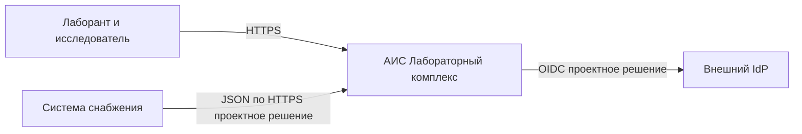
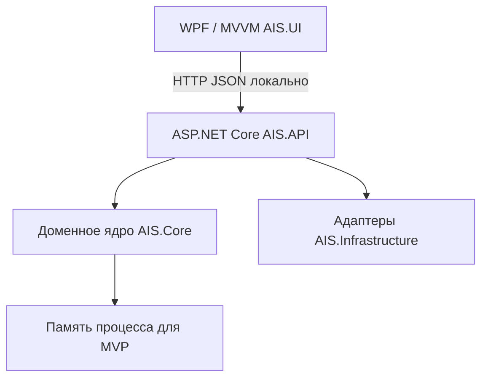
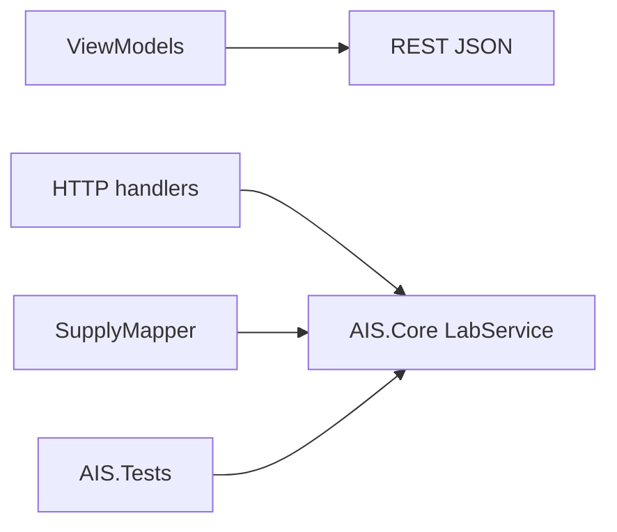

# ПР2 и ПР7 — контекст, контейнеры и компоненты C4

## C4 Level 1 — Context

## C4 Level 2 — Containers

## C4 Level 3 — Components and dependency rule

На этапе MVP используется память процесса; PostgreSQL, OIDC и система
снабжения показаны как **планируемые внешние интеграции**, не как подключенные.
